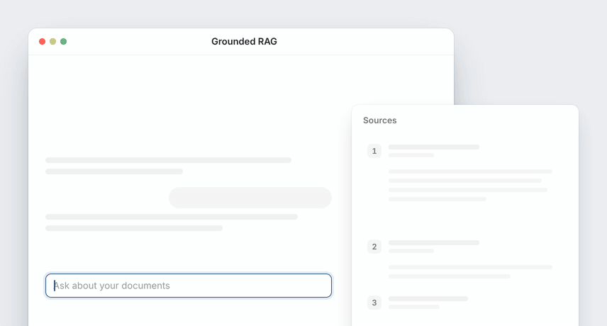
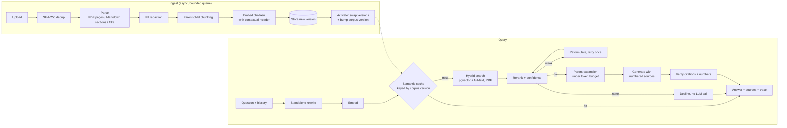
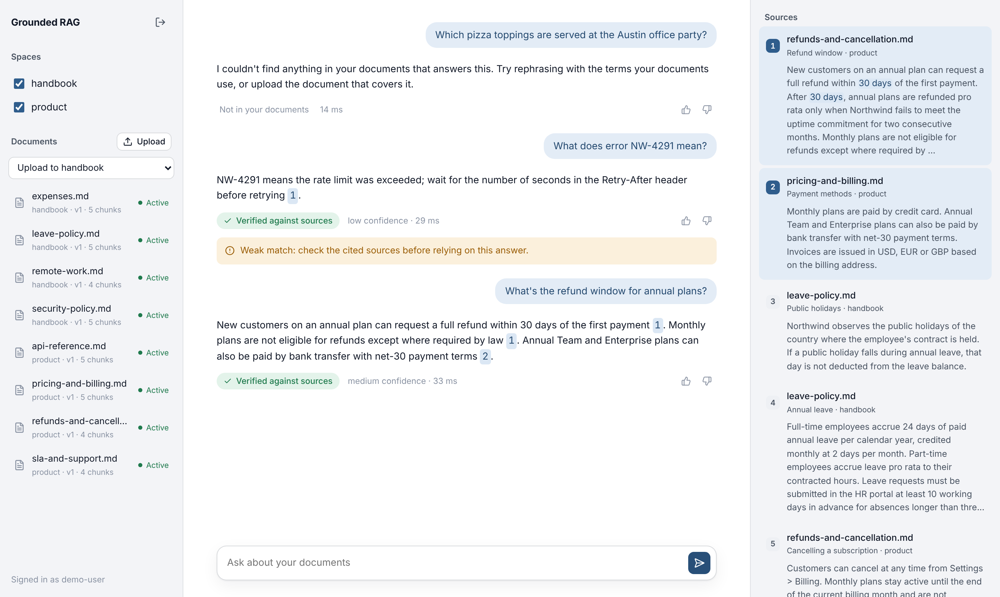

# Grounded RAG

[](https://github.com/tatsat3mutee/grounded-rag/actions/workflows/ci.yml)


A multi-tenant document question-answering service built on **Java 25, Spring Boot 4.2 and Spring AI 2.1**.
Every answer cites its sources, is checked against them before it is returned, and comes with a
confidence level. When the documents do not contain the answer, the service says so instead of
guessing, and it decides that without spending an LLM call.



## Why this exists

Most RAG demos stop at "embed, top-k, prompt". The failures that hurt in production come after
that: answers that cite sources that don't exist, numbers the model made up, follow-up questions
that retrieve nothing, caches serving answers about deleted documents, one tenant reading
another's files, and a re-upload that leaves a document half-indexed. This project is built around
those failure modes. Each one is handled in code, covered by a test, and explained in a design
record (ADR).

| Failure mode | How it's handled | Where |
|---|---|---|
| Model cites a source that doesn't exist, or invents a figure | Every answer is verified: citations must map to real sources, and every number must appear in the evidence | `GroundingVerifier`, [ADR 7](docs/adr/0007-verify-every-answer.md) |
| Answers off-topic questions with confident nonsense | Confidence policy: decline without calling the LLM when evidence is missing; caveat when it is weak; one corrective re-query first | `RagService`, [ADR 5](docs/adr/0005-confidence-and-abstention.md) |
| Follow-up questions ("and for annual plans?") retrieve nothing | Follow-ups are rewritten into standalone questions before retrieval and caching; history is Spring AI `ChatMemory`, persisted in Postgres | `QueryRewriter`, `ConversationMemory` |
| Cache serves answers about content that changed | Cache key includes a per-space corpus version that every ingest/delete bumps | `SemanticCache` |
| Tenant isolation trusts a request header | Spaces come from the authenticated caller (API key, or an OIDC/JWT claim filled by your identity provider); requests for other spaces get 403 (fails closed) | `SpaceAuthorizer`, `JwtCallerConverter`, [ADR 8](docs/adr/0008-tenancy-from-credentials.md) |
| One tenant burns the shared LLM budget | Per-caller token bucket on chat and upload, `429` with `Retry-After` | `RateLimitFilter` |
| Multi-space search silently ANDs filters | `= ANY(...)` filters, covered by a contract test on both stores | `KnowledgeStoreContract` |
| Small tenants get zero vector hits (filtered HNSW returns its 40 nearest rows, the filter removes them all) | pgvector iterative scan; demonstrated with `EXPLAIN ANALYZE`: 0 rows without it, 30 rows in 2.2 ms with it | `JdbcKnowledgeStore`, [PERFORMANCE](docs/PERFORMANCE.md) |
| Re-upload deletes the old version before the new one is ready | Versioned ingestion: the old version serves until the new one is fully indexed, then one transaction swaps them | `IngestionService`, [ADR 6](docs/adr/0006-versioned-ingestion-and-state.md) |
| Embedding model changed, old vectors silently incomparable | Model name stored per document version; startup check warns; dimension mismatch fails fast | `Embedder`, `StartupChecks` |
| PII ends up in the index, the cache and the LLM provider | Redacted at ingest (cards only when Luhn-valid) | `PiiRedactor` |
| Config flags that do nothing | Typed `@ConfigurationProperties`; every value is read by code | `RagProperties` |
| "Quality dashboard" with placeholder values | Each answer persists a trace with real chunk ids, scores, verification and per-stage timings; feedback attaches to it | `AnswerTrace` |
| Nobody knows if a change made retrieval worse | A golden-set evaluation runs in CI and fails the build below baseline; an LLM-as-judge faithfulness score runs offline | `RetrievalQualityGateTest`, `FaithfulnessJudge`, [EVALUATION](docs/EVALUATION.md) |
| The architecture diagram drifts from the code | ArchUnit rules fail the build on layering violations and package cycles | `ArchitectureTest`, [ADR 9](docs/adr/0009-enforced-quality-gates.md) |

## Architecture



Details: [docs/ARCHITECTURE.md](docs/ARCHITECTURE.md). Design decisions: [docs/adr](docs/adr).

## Run it

Requires JDK 25; the build stops with a clear message on an older JDK. Docker is optional.

**Zero setup** (in-memory store, offline embeddings, extractive answers; no API key, no Docker):

```bash
./mvnw spring-boot:run
```

Open http://localhost:8080, enter the dev key `dev-key-change-me-0001`, upload files from
`eval/corpus/`, and ask questions.



**Production-like** (Postgres + pgvector with a Flyway-managed schema):

```bash
docker compose up --build
```

**With a real LLM.** Any OpenAI-compatible endpoint works, including OpenAI, Groq, OpenRouter and vLLM:

```bash
OPENAI_API_KEY=sk-... ./mvnw spring-boot:run -Dspring-boot.run.profiles=openai
```

**Fully local LLM** (Ollama) plus a cross-encoder reranker:

```bash
APP_PROFILES=postgres,ollama,rerank docker compose --profile ollama --profile rerank up --build
```

Then pull the two Ollama models into the running container:

```bash
docker compose exec ollama ollama pull llama3.2
```

```bash
docker compose exec ollama ollama pull nomic-embed-text
```

All profiles and properties: [docs/CONFIGURATION.md](docs/CONFIGURATION.md).

## API

| Method | Path | Purpose |
|---|---|---|
| `POST` | `/api/v1/spaces/{space}/documents` | Upload (multipart `file`). `202` with a QUEUED version to poll; `200` if the bytes are already indexed |
| `GET` | `/api/v1/spaces/{space}/documents[/{id}]` | Versions and their status (QUEUED, INDEXING, ACTIVE, SUPERSEDED, FAILED + reason) |
| `DELETE` | `/api/v1/spaces/{space}/documents/{id}` | Delete all versions of that source |
| `POST` | `/api/v1/chat` | `{question, conversationId?, spaces?}` returns answer, sources[], confidence, verification, timings |
| `POST` | `/api/v1/chat/stream` | Same, as server-sent events: `meta` (sources first), `token`*, `done` |
| `GET` | `/api/v1/answers/{id}` | The trace behind an answer (chunk ids, scores, timings), owner only |
| `POST` | `/api/v1/answers/{id}/feedback` | `{rating: 1 or -1, comment?}` |
| `GET` | `/actuator/health`, `/actuator/prometheus` | Probes and metrics (`rag.stage`, `rag.answers`, `rag.ingest`) |

**From agents (MCP).** `/mcp` serves `search_documents` and `ask_documents` over streamable HTTP, with the
same authentication, space rules and rate limit:

```bash
claude mcp add --transport http grounded-rag http://localhost:8080/mcp --header "X-API-Key: dev-key-change-me-0001"
```

**From other Spring AI code.** The `groundedRagAdvisor` bean is a `RetrievalAugmentationAdvisor` built
from this service's retriever and rewriter. How, and which Spring AI features are used where:
[docs/SPRING_AI.md](docs/SPRING_AI.md).

All `/api` calls need either an `X-API-Key` header or, when `rag.security.jwt.*` is configured,
an `Authorization: Bearer <JWT>` from your identity provider. Errors are RFC 9457 problem details.

## Evaluation

The golden set has 37 questions over 8 fictional policy and product documents: plain lookups,
paraphrases, exact identifiers like error codes, cross-space questions and unanswerable ones.
It runs on every build.

| Retrieval (offline CI, k=6) | Recall@6 | MRR | nDCG@6 |
|---|---|---|---|
| Hybrid (RRF) | 1.000 | 0.890 | 0.919 |
| Vector only | 0.941 | 0.777 | 0.821 |
| Keyword only | 1.000 | 0.951 | 0.964 |

| End to end (offline CI) | Value |
|---|---|
| Unanswerable questions correctly declined | 3 / 3 |
| Answerable questions wrongly declined | 3 / 34 (all paraphrases) |
| Answers that passed verification | 34 / 34 |
| Answers containing the expected fact | 28 / 34 |

These numbers use the offline hashing embedding, which is lexical, so keyword-only search wins
here. That is expected, and it is reported as measured rather than hidden. The same harness runs
against real models with one flag. Method, the confidence-calibration analysis, and how to
reproduce: [docs/EVALUATION.md](docs/EVALUATION.md).

## Performance

Service overhead with offline models (so model latency is excluded), on 4 CPUs and JDK 25:

| Store | Chunks | Retrieve p50 / p95 | Full answer p50 / p95 |
|---|---|---|---|
| Postgres (pgvector HNSW + GIN) | 9,250 | 12.9 / 38.8 ms | 22.5 / 75.3 ms |
| In-memory | 9,250 | 13.9 / 21.1 ms | 33.8 / 55.3 ms |

On Java 25 the container starts in about 1.9 s instead of 4.2 s, thanks to an AOT cache recorded at
image build. Compact object headers cut live heap by 7%.

Profiling with `EXPLAIN ANALYZE` cut Postgres retrieval p50 from 36 ms to 12.5 ms. Keyword
search computed cosine distance for every matched row, and the two search legs ran one after the
other. Method, the 46k-chunk run, and the iterative-scan evidence: [docs/PERFORMANCE.md](docs/PERFORMANCE.md).

## Quality gates

`./mvnw verify` (CI on every push) runs 126 tests and fails the build on any of these:

- **Architecture rules (ArchUnit):** domain packages carry no Spring web or security types, only
  the store touches JDBC, and there are no package cycles.
- **Store contracts:** the same tests run against the in-memory store and real Postgres + pgvector
  (Testcontainers, which also exercises the Flyway migration and its indexes).
- **API tests**, including JWT validation (expired, forged, wrong audience) and rate limiting.
- **MCP tests** with the official MCP Java client: tools listed, cited search, verified answers,
  forbidden spaces refused, no key no connection.
- **Spring AI integration tests:** the retriever inside a real `ChatClient` + `RetrievalAugmentationAdvisor`,
  and conversation memory on both the in-process and JDBC repositories.
- **A streaming test over a real socket.** It catches the SSE/async-dispatch security bug that MockMvc cannot.
- **The evaluation quality gate** on the golden set.
- **Line coverage ≥ 85%** (JaCoCo; currently about 92%).

## Project layout

```
src/main/java/io/groundedrag/
  domain/        SpaceId, document/chunk records, the shared TextAnalyzer
  ingestion/     parse -> redact -> chunk -> embed -> versioned activate
  store/         KnowledgeStore port, in-memory and JDBC (pgvector) adapters
  retrieval/     embedder, hybrid retriever (RRF), rerankers, context assembler
  generation/    query rewriting, answer generation (LLM / extractive), verification
  chat/          RagService pipeline, conversation memory, API response model
  cache/         semantic cache with corpus-version invalidation
  observability/ answer traces and feedback
  security/      API-key and JWT authentication, space authorisation, rate limiting
  springai/      Spring AI modular RAG adapters (DocumentRetriever, QueryTransformer)
  mcp/           MCP tools for agents
  eval/          golden-set evaluator and runner
  config/        composition root and typed properties
  web/           REST + SSE controllers, problem details
eval/            golden set and fictional corpus
docs/            architecture, ADRs, evaluation, performance, configuration, interview guide
```

## Known limitations

- The answer cache is in-process (correct across replicas because it is keyed by corpus version,
  but not shared). Conversation memory is persisted in Postgres through Spring AI's
  `JdbcChatMemoryRepository`.
- Scanned PDFs need OCR, which is not included.
- The offline profile cannot handle paraphrases. That is the measured case for running the
  cross-encoder profile ([EVALUATION](docs/EVALUATION.md)).
- Rate-limit buckets are per instance; use Redis (Bucket4j) for a global limit across replicas.
- Access control is per space. Per-document ACLs would be a pre-filter in the store.

## Related

[mtech-teleco-multiagent-project](https://github.com/tatsat3mutee/mtech-teleco-multiagent-project)
is the agentic counterpart, in Python. It is a LangGraph multi-agent system (investigator,
reasoner, critic, reporter) with GraphRAG for root-cause analysis of telecom billing anomalies.
This repository focuses on production document Q&A; that one focuses on multi-step agent reasoning.
