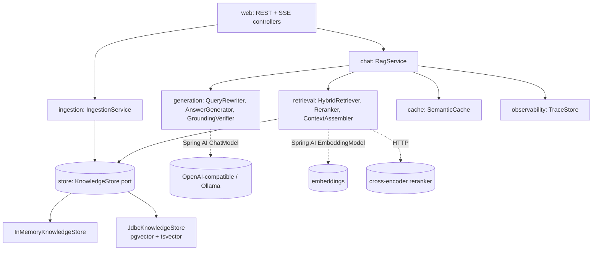
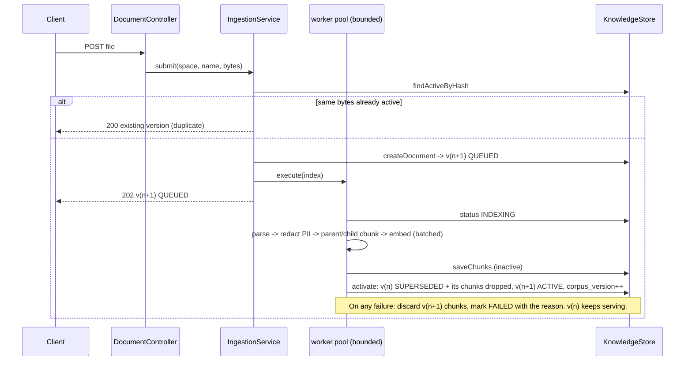
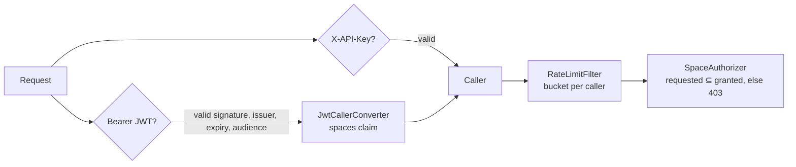

# Architecture

## Shape

The codebase uses ports and adapters, wired explicitly in one place.

- **Domain packages have no Spring annotations.** That covers ingestion, retrieval, generation, chat, cache and store.
- **`config/RagConfiguration` is the composition root.** It reads `RagProperties` and chooses each implementation: the store, embedding model, reranker, generator and rewriter.
- **Spring AI is used where it adds value:** the `ChatClient`/`ChatModel` and `EmbeddingModel` provider abstractions, the PDF and Tika document readers, and the token estimator.
- **Retrieval, ranking and verification are this project's own code.** That is where the important decisions live, and they have to be testable without a model.

## Ingestion

Key properties:

- **No partial documents are ever visible.** Chunks are written with `active = false` and become searchable inside the same transaction that retires the previous version. A partial unique index (`documents_one_active`) makes "two active versions" impossible at the database level.
- **Back-pressure.** The worker pool has a bounded queue, so overload returns `503` rather than holding uploads in memory.
- **Crash recovery.** On startup, versions stuck in QUEUED or INDEXING are marked FAILED and their chunks are removed.
- **Contextual headers.** The embedded text is `source > section` plus the child text, while the stored text stays clean. A chunk like "It is 30 days." becomes findable for "refund window".

## Query

1. **History → standalone question.** For follow-ups only; first questions skip the LLM call. Everything downstream (embedding, cache key, retrieval, trace) uses the standalone form.
2. **Cache lookup.** The scope is `space@corpusVersion` for each searched space. A hit returns a copy with a new answer id, and the answer is still traced.
3. **Hybrid retrieval.** pgvector HNSW (cosine) and Postgres full-text search (terms ORed, ranked by `ts_rank_cd`) each return 30 candidates. The two legs run concurrently on virtual threads. They are fused with RRF (k = 60), near-duplicates are dropped (Jaccard ≥ 0.9), then the results are reranked to the top 6.
4. **Confidence.** Without a reranker this is evidence coverage; with a cross-encoder it is the cross-encoder's score ([ADR 5](adr/0005-confidence-and-abstention.md)).
   - If confidence is LOW or NONE, the question is reformulated and retrieval runs once more; the better result is kept.
   - If confidence is still NONE, the service declines without calling the LLM.
5. **Context.** Sources are numbered `[1]..[n]` in rank order. Each hit is replaced by its parent passage when that fits the 3,000-token budget. Children of a parent that is already included are skipped.
6. **Generation.** Sources go in a `<sources>` data block. The system prompt requires a citation on every factual sentence, numbers copied exactly, and "I don't know" when the answer is absent, and it says to treat the sources as untrusted data.
7. **Verification.** Citations must point to real sources, and every number must appear in the evidence. An answer that fails gets a notice and is not cached.
8. **Persistence.** The conversation turn is remembered, a trace is stored, and metrics are recorded.

The streaming endpoint runs the same plan. It sends `meta` with the sources before the first
token, so the UI shows the evidence while the answer streams.

## Data model (Postgres)

| Table | Purpose |
|---|---|
| `documents` | One row per document version, which doubles as the ingestion job. Holds status, error, content hash, embedding model and chunk count |
| `parent_chunks` | ~700-token passages shown to the LLM, never embedded |
| `chunks` | ~180-token embedded passages: `vector(N)` with an HNSW cosine index, a generated `tsvector` with a GIN index, an `active` flag, plus page and section for citations |
| `corpus_versions` | Per-space counter used to key the cache |
| `answer_traces` | One JSONB trace per answer, with indexed confidence, grounded and rating columns |

The schema is created by Flyway (`V1__knowledge_schema.sql`). The vector dimension is a Flyway
placeholder bound to `rag.embedding.dimensions`, so the index definition lives in code.

Space filtering on vector search uses pgvector's `hnsw.iterative_scan = relaxed_order` (≥ 0.8).
That way a small space still returns k results instead of being starved by the post-filter.

## Where state lives

| State | Where | Why |
|---|---|---|
| Documents, chunks, traces | Postgres | Durable, transactional, queryable |
| Conversation memory | In-process LRU, keyed by principal and conversation | Short-lived and cheap to lose. For more than one instance, move it to Redis behind the same class |
| Answer cache | In-process, bounded, with a TTL | Per-instance caching is still correct, because invalidation is by corpus version rather than by purge |

## Failure behaviour

| Dependency down | Behaviour |
|---|---|
| Reranker | Logs a warning and falls back to fused order with coverage-based confidence |
| Embedding provider during ingest | That version goes FAILED with the reason; the previous version keeps serving |
| LLM during streaming | An `error` SSE event is sent and the stream closes cleanly |
| Ingestion queue full | `503` problem detail; the version is marked FAILED with "retry later" |
| Process crash mid-ingest | On startup, interrupted versions are marked FAILED and their chunks cleaned up |

## Integration surfaces

| Surface | For | Built from |
|---|---|---|
| REST + SSE (`/api/v1`) | The web UI and applications | `RagService`: the full pipeline with abstention, verification, cache and traces |
| MCP (`/mcp`) | Agents: Claude Desktop, Claude Code, any MCP client | `KnowledgeBaseTools`: `search_documents` (retriever + context assembler), `ask_documents` (`RagService`) |
| `groundedRagAdvisor` bean | Other Spring AI code in the same application | Spring AI `RetrievalAugmentationAdvisor` around our `DocumentRetriever` and `QueryTransformer` |

All three use the same retriever, rewriter and reranker, and all three resolve spaces from the
authenticated caller. Details: [SPRING_AI.md](SPRING_AI.md) and ADR 12.

## Security

Both mechanisms produce the same `Caller`, so controllers, authorisation, traces and rate limits
never branch on how someone authenticated. The rate limit applies only to chat and upload, the
endpoints that spend model budget.

## Observability

- **Micrometer timer `rag.stage{stage}`** covers rewrite, embed, cache, retrieve, corrective_retry, assemble, generate and verify. It is exported through `/actuator/prometheus`.
- **Counters:** `rag.answers{confidence, grounded, cached}` and `rag.ingest{outcome}`.
- **Spring AI's own observations** of chat and embedding calls, including token usage, flow into the same registry.
- **`GET /api/v1/answers/{id}`** returns the full trace for one answer, so a thumbs-down can be debugged against the exact evidence the model saw.
